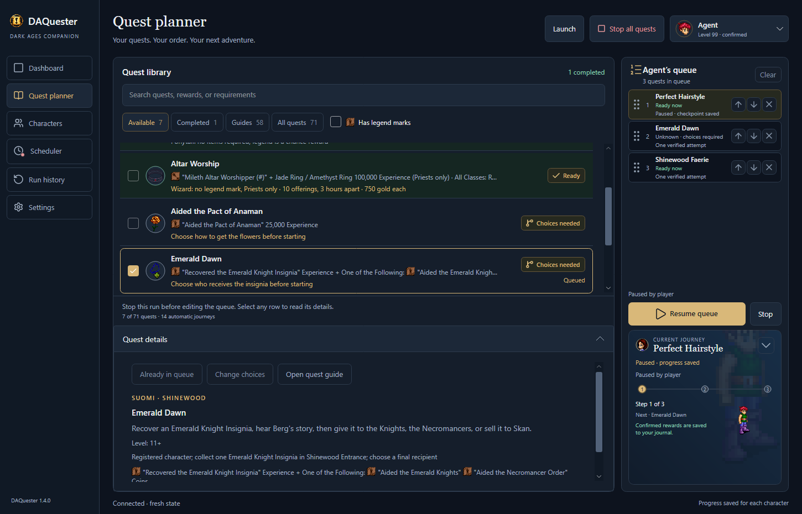
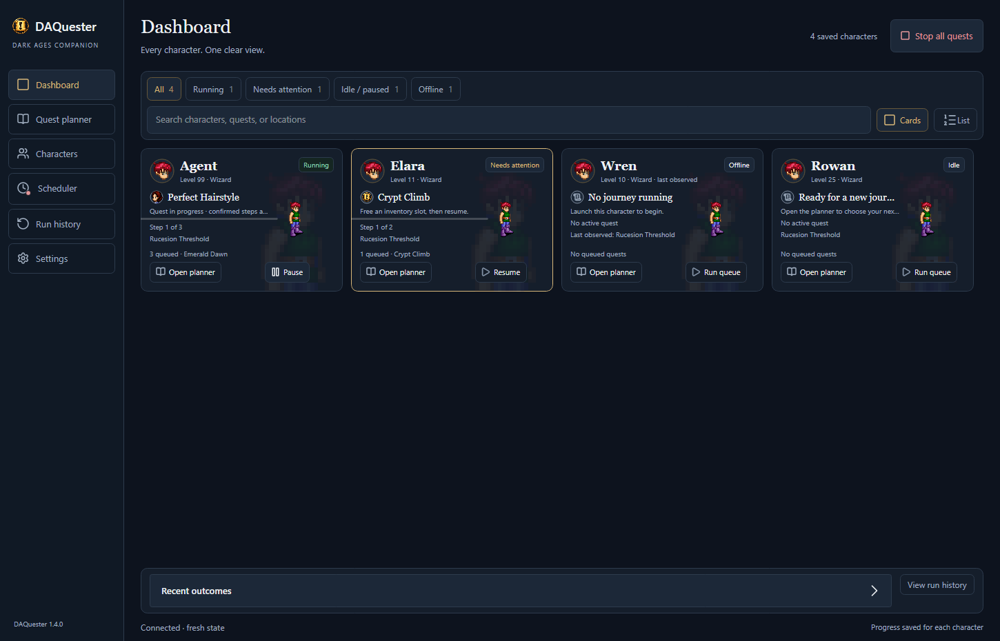

# DAQuester

DAQuester is a quest companion for your Dark Ages characters. Plan a journey,
put quests in your preferred order, and keep each character's progress together.
The Avalonia desktop app pairs a quiet, fully dark journal with clear quest
details, original character sprites, a queue you can pause and return to, and
optional scheduled work that can keep running in the system tray.

[Download for Windows](https://github.com/BuildWithRaymond/DAQuester/releases/latest)
· [Setup guide](docs/GETTING_STARTED.md)
· [1.7.2 release notes](docs/releases/v1.7.2.md)
· [Report a bug](https://github.com/BuildWithRaymond/DAQuester/issues/new/choose)

This README describes current source. See the release notes for changes included
in a particular download, and [validation](docs/validation.md) for current checks
and remaining live-run limits.



## What you can do

- **Watch all your characters.** Dashboard offers cards and a compact list with
  connection state, current journeys, queues, recent outcomes, and pauses needing
  attention. Open a character's planner to review or resume its saved progress.
- **See original game sprites.** Character portraits, animated journey sprites,
  and quest artwork come from your selected game installation. Observed outfits
  stay remembered after logout; characters without an observed outfit use a
  clothed default drawn from the same original artwork. Artwork caches keep
  scrolling and filtering responsive. Game assets are not included in downloads.
- **Build a queue for each character.** Search the quest library, check the
  quests you want, then drag them into order. Move buttons and keyboard shortcuts
  work too. Each queue entry runs one attempt; cooldowns still apply.
- **Make room for the library.** Fold the journey below the queue controls into a small bar.
  Your progress and separate queue stay visible, and expanding restores
  the full card. The fold animation respects Windows reduced-motion settings.
- **See what your character can run.** Ready quests have a green tint. Finished
  legend goals show Completed. Other rows explain choices, cooldowns, missing
  requirements, or guide-only status. Disabled checkboxes and tooltips explain
  why a quest cannot be queued. You can arrange a queue while disconnected;
  running it still requires a connected character and checked requirements.
  DAQuester remembers observed levels and own legends between sessions.
- **Launch from your character list.** Each saved character has a Launch button.
  Save a password for automatic sign-in, or leave it blank and sign in yourself.
  Saved passwords are encrypted by Windows. You can launch another character
  while one logs in; saved logins are entered one at a time. New clients use
  bundled DAWindower X automatically. Its **+** opens a fresh blank login through
  DAQuester; use a saved character's Launch action for saved login.
- **Prepare supplies before the journey.** Buy or gather known missing supplies
  for ready queued quests, within available gold, bag space, and reward reserves.
  Already carried items count. Quest acceptance gates still apply, and uncertain
  purchases keep a saved checkpoint before dialogue continues. Eligible Wizards
  and Priests can also prepare dachaidh after their known prerequisites and the
  trainer's current quote are checked; Wizards must supply their own Skull.
- **Bring flowers with your other characters.** For either Paulin flower quest,
  pick one flower a day yourself or choose saved helpers to pick and trade flowers
  to the quester. Helpers DAQuester logs in are logged out after their trade;
  helpers already online stay online.
- **Travel in fast mode.** Fast mode defaults on for each character and can be
  switched off in Settings. Your own connected characters do not slow each
  other's walking; other nearby players still do.
- **Keep your progress.** Quest checkpoints, queue order, rewards, and run history
  stay with the character. Each queue finishes after its last verified quest attempt.
  Saved Spare a Stick turn-ins can recover from matching recorded evidence without
  handing in again. Newly verified outcomes play a brief blue spiral over the
  character; a small notice shows completions for characters you aren't viewing.
- **Schedule eligible quests.** Optional Scheduler saves one-time or supported
  recurring attempts. Save entries, acknowledge the login warning, then choose
  **Turn on saved schedules**. Stopped entries have a separate **Resume schedule**
  action. Scheduler is off by default. It launches saved characters for eligible
  work and closes only the clients it opened when that run ends.
- **Keep scheduling from the tray.** Closing the window keeps DAQuester running
  in the system tray by default. Reopen it from the tray icon; its menu shows
  scheduling status and offers Pause scheduling and Exit DAQuester. Settings can
  disable tray mode or optionally start DAQuester when you sign in to Windows.
  Sign-in startup is off by default and never enables schedules. Keep Windows
  signed in and the PC awake; signed-out execution is not supported.
- **Run Auto Tasks.** Search activities separately from the quest library.
  Wizardy research buys missing parchment, follows the selected research setup,
  verifies outcomes, and repeats until the server's rest or a blocker. Failed
  experiments with the observed retained-scroll outcome reuse that parchment.
  Altar Worship preserves its offering count and waits between eligible runs.



See the [Dashboard list](docs/screenshots/dashboard-list.png) and
[optional Scheduler](docs/screenshots/scheduler.png) for their alternate views.


Expand a character and choose **Legend marks** beside **Remove** to open a compact
list with original mark icons and full text and dates. The popup keeps the dark
theme and labels offline marks as last observed. See the
[legend popup](docs/screenshots/legend-marks.png).

## Get started

1. Download **DAQuester-win-Setup.exe**, or extract **DAQuester-win-Portable.zip**
   from [Releases](https://github.com/BuildWithRaymond/DAQuester/releases/latest).
   Both include the .NET runtime; players do not need a separate .NET installation.
2. In **Settings**, select your supported `Darkages.exe`. Restart DAQuester if you
   change that path.
3. In **Characters**, add your character names and optional passwords, then click
   **Save accounts**. Use the character's **Launch** button to open the game.
   With no saved characters, the top **Launch** button opens a blank client for
   manual sign-in.
4. Choose your character in the planner, select quests, arrange the queue, and
   click **Run queue** with the play icon. Some quests ask you to choose an outcome first.

DAQuester supports Windows and the exact **DATester 7.41** client documented in
[client provenance](docs/provenance.md). Launch clients through DAQuester; it
doesn't attach to clients that are already open. The game itself isn't included.

The supported profile includes walkability data for **1,420 recorded maps**.
Travel uses it automatically when the client has no cached map data, so moving
DAQuester to another PC does not require copying a populated map cache. Fifteen
recorded maps remain uncovered; movement pauses if neither source has usable
collision data. Raw game maps and artwork are not bundled.

## Available quests

The quest library includes guides and automatic recipes:

| Quest | What to expect |
| --- | --- |
| Awakening | Follows the starter tutorial through Raghnall and Bartley, then verifies the wake-up in Mileth Inn Room 0 and its rewards. |
| Peasant's First Steps | Needs **50,000 gold**. Buys and equips starter gear, trains in the first two Mileth Crypt floors to level 7, and finishes with a Loures Saber equipped. Allocates stat points to CON and WIS. |
| Crypt Climb | Uses the First Steps gear to reach level 11 in the first two Crypt floors, then returns to the Vestibule. Allocates CON and WIS. Characters below level 10 without a Terror mark must accept losing that quest window. |
| Spare a Stick | Levels **1–11** only. Accepts Callough's task before gathering six branches, then verifies his rewards. Ordinary attempts have an eight-hour cooldown. A mark outcome stops repeats; Scheduler shows the observed mark and offers an explicit choice to try for higher numbered marks. Verified sessions drop leftover Stick and Wooden Shield bag items. |
| Mundane Birth | Choose your season, age, and town before starting. Runs once; an existing birth legend prevents another selection. |
| Perfect Hairstyle | Follows Eeva's Ponytail conversation. Weekly attempts can continue until your own Suomi legend is recorded. |
| Entered Muisir Village | Collects five Undine Mushrooms and verifies the legend and four Shrinking Potions. An existing Muisir legend shows Completed. |
| Emerald Dawn | Find an insignia, hear Berg's story, then choose Knights, Necromancer, or sale. The choice can change until the hand-over. All three outcomes are live-verified. |
| Wolf of West Woodlands | Follows Throttler's woodland quest, handles the observed entrance warning, and verifies a named potion, 60,000 XP and the own Wolf legend. Accepts Vanilla Potion or Fifleaf deum. A fresh full automatic run remains unverified. |
| Shinewood Faerie | Level **11+** to pass Forest 7. Try for a pet and learn eligible missing Priest/Wizard spells. The known successful bond asks for **250 HP and 250 MP**; the runner accepts that exact offer and verifies the Pet Faerie. Handles the failed-bond wait and return trip. A fresh automatic bond run remains unverified. |
| Cured the Sick Child | Level **11+**. Give Paulin five Sevti Blossoms with **5,000 gold per flower**. Pick daily or use helpers; completion requires your own sick-child legend. |
| Aided the Pact of Anaman | Give Paulin five Tulsi (Golden) Blossoms **without gold**. Uses the same daily/helper options; its brown legend mark is hidden from other players. |
| Altar Worship | Offers a Leather Shield at the Mileth Altar every three hours, buying one for **750 gold** if needed. Stops after ten offerings. Priests, Bards and Master Priests can earn the legend; other classes must confirm they want the experience and ring instead. |
| Fisk's Secret | Preserves the secret, buys missing supplies and saves the paid bouquet wait. Runs other ready queued work meanwhile, or waits at a free Tavern spot facing down. Collection requires the actual Bouquet. |
| Cap / Band of Danaan | One family journey through Donnan/Cail, including captured original, Loures orders, court, and Fiosachd referrals. Desktop uses the fixed Cail route and supplied-Mold rite without a choice popup. Mold remains required. Saved reply and reward cleanup recover without repeating handoffs; unknown dialogue pauses. |

Each character can pick one flower a day across both flower quests. With enough
eligible helpers, all five turn-ins can finish in one day. The two legend marks
exclude each other: earning either prevents the other quest. Refused picks and
recorded pick times stay visible, and you can enter flowers already given by hand
before starting.

The remaining entries are guides for manual play. See [quest details](docs/QUESTS.md)
for requirements, repeat rules, and the evidence behind each recipe. Both flower
quests have recorded live completions, including helper picking, trading and
logout. The complete queue and broader sign-in recovery flows retain synthetic
coverage; those runs do not establish live success. Current results and limits
are in [validation](docs/validation.md).

Wizardy research has live verification of automatic parchment purchase, successful
Song results, repeated failed experiments with retained parchment, and the final
12-hour server rest with popup cleanup. It uses carried parchment first and
checks the exact 500-gold quote and both receipts before buying another. Song
banking, assistant work and other outcome variants retain the limits in the
[task guide](docs/QUESTS.md#tasks-wizardy-research). Unknown replies and uncertain
submissions pause rather than spend or submit again. Scheduled runs close their
owned clients after the verified rest; a manually launched client stays under
manual control. A schedule blocked by an already-open client needs explicit
Resume after that client is closed.

Fisk's secrecy path and the Cail/Cap outcome have observed MCP completions.
Their new full automatic runners have synthetic coverage and still require fresh
automated live validation. Band-specific dialogue and other Avatar routes remain
unverified. See the [automation handoff](docs/research/fisk-danaan-automation.md).

Shinewood Faerie ends after safe return to **Shinewood Forest 1**, or a verified
town song/scroll or dachaidh escape. It does not require walking farther into Mileth.

Altar Worship's first automated offering is live-verified; the full ten-offering
run and final rewards have synthetic coverage only. Starter training uses the
shared melee system, which also supports the
[local control bridge](docs/control.md#melee-combat). Hunting can fight bare-handed
when no usable melee weapon is owned; shrine entry requirements still apply.

## Updating

Open **Settings → Check for updates**, then **Download update**. When you've
finished your quests and closed DAQuester-launched game clients, choose
**Install and exit**. Startup checks are optional and off by default.

Your data lives in `%LOCALAPPDATA%\DAQuester\Data`, outside the update package.
If you're coming from an early folder build, read [existing data](docs/GETTING_STARTED.md#existing-data)
before first launch. Packages are unsigned; checksums and recovery instructions
are covered in [releasing](docs/RELEASING.md).

## Build from source

Use Windows and the [.NET 10 SDK](https://dotnet.microsoft.com/download/dotnet/10.0).
You don't need a game installation to build or run the synthetic checks.
The first app build also needs Git, Python 3.9+, Visual Studio 2022 C++ x86 tools,
and CMake to build pinned DAWindower X from public source. Later builds reuse its
verified native artifact cache. See [Contributing](CONTRIBUTING.md) and
[CI](docs/CI.md) for details.

```powershell
git clone https://github.com/BuildWithRaymond/DAQuester.git
cd DAQuester
dotnet restore DAQuester.slnx -m:1
dotnet build DAQuester.slnx -c Release --no-restore -m:1
dotnet test tests/DAQuester.Tests -c Release --no-build -m:1
dotnet test tests/DAQuester.AppTests -c Release --no-build -m:1
```

| Folder | Contents |
| --- | --- |
| `src/DAQuester.App` | Avalonia views, view models, desktop orchestration, accounts, and updates |
| `src/DAQuester.Core` | Quest rules, saved journals, queues, and character memory |
| `src/DAQuester.DarkAges` | Game protocol, proxy, client launch, and navigation |
| `tests` | Core/protocol and app behavior regressions; no real character actions |
| `content` | Recipes, catalog, routes, functional walkability, calibration, and sanitized evidence |
| `native` | Pinned DAWindower X source metadata and DAQuester integration patch |
| `docs` | Player guides, contributor references, release notes, and screenshots |
| `tools` | Optional screenshots, content tools, and release packaging |

Start with [Contributing](CONTRIBUTING.md) or browse the [documentation index](docs/README.md).
Calibration, connection profile, diagnostics and replay export are reachable through
the [control bridge and MCP](docs/control.md) and the Data folder, not the window.
Documentation screenshots are optional: run `./tools/Capture-Screenshots.ps1`
after a Release build with isolated sample data. To show original sprites and
quest icons, set the artwork source before capture:

```powershell
$env:DAQUESTER_SCREENSHOT_CLIENT = 'C:\path\to\Darkages.exe'
./tools/Capture-Screenshots.ps1
```

Capture reads installed artwork without launching a game client. Four main pages
are copied to `docs/screenshots`; additional dashboard, scheduler, and journey
captures stay under `artifacts/screenshots/native` for manual selection and review.

## Related projects and credits

[DAOrganizer](https://github.com/BuildWithRaymond/DAOrganizer) manages inventories
and banks; its saved-login approach is also used here.
[DAMerchant](https://github.com/BuildWithRaymond/DAMerchant) handles trading, and
[DASpeaker](https://github.com/BuildWithRaymond/DASpeaker) prepares speeches.

DAQuester is [MIT licensed](LICENSE). It uses .NET, [Avalonia](https://avaloniaui.net),
[Arbiter](https://github.com/ewrogers/Arbiter), and
[Velopack](https://github.com/velopack/velopack). Windowed clients use
[DAWindower X](https://github.com/BuildWithRaymond/DAWindower), built from pinned
source with DAQuester's managed-launch integration. Quest references come from
[Vorlof](https://vorlof.com/quests.html). See [third-party notices](THIRD_PARTY_NOTICES.md)
for upstream licenses.

Screenshots show the actual app with isolated sample characters and original
sprites rendered from installed game artwork. Dark Ages belongs
to its owners; DAQuester is an independent community project.
