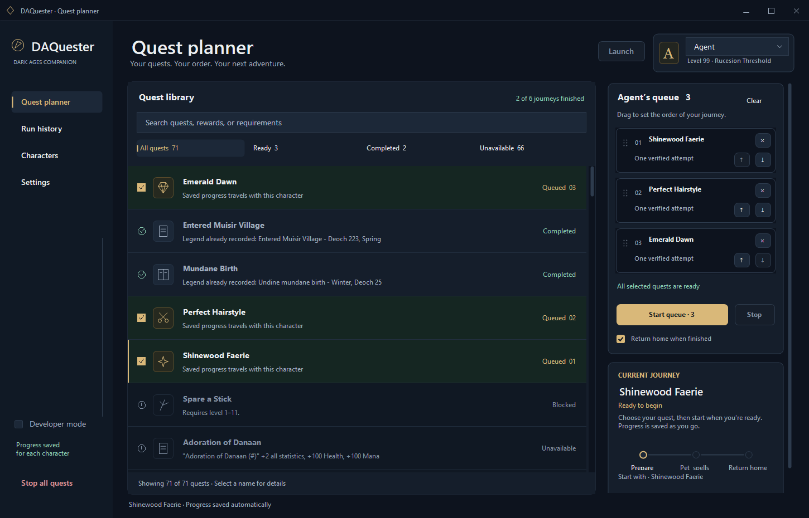
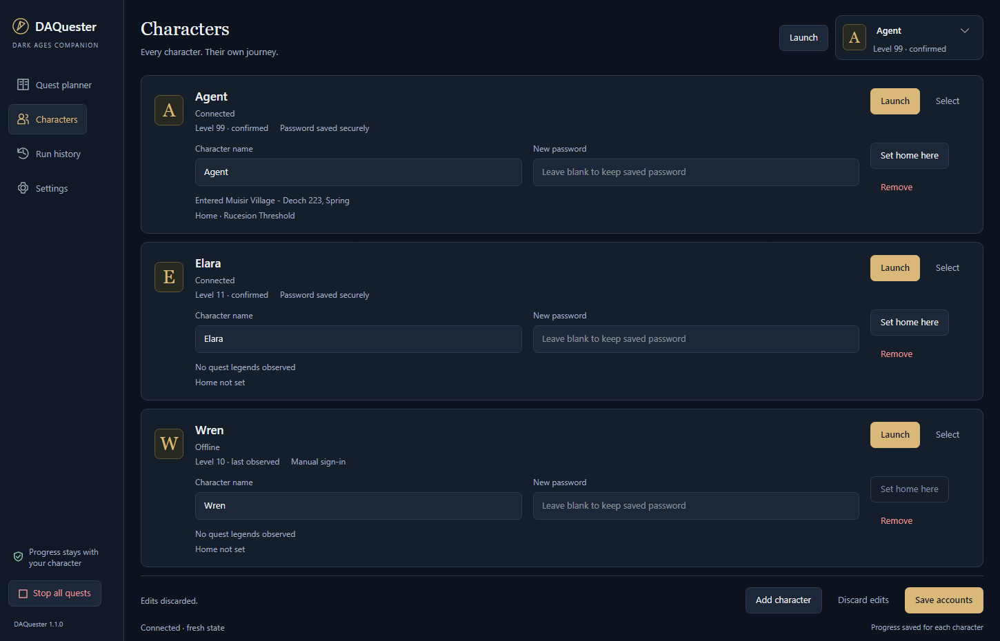

# DAQuester

DAQuester is a quest companion for your Dark Ages characters. Plan a journey,
put quests in your preferred order, and keep each character's progress together.
The new Avalonia desktop app pairs a quiet, fully dark journal with clear quest
details, remembered character facts, and a queue you can pause and return to.

[Download for Windows](https://github.com/BuildWithRaymond/DAQuester/releases/latest)
· [Setup guide](docs/GETTING_STARTED.md)
· [What's new in 1.1.1](docs/releases/v1.1.1.md)
· [Report a bug](https://github.com/BuildWithRaymond/DAQuester/issues/new/choose)



## What you can do

- **Build a queue for each character.** Search the quest library, check the
  quests you want, then drag them into order. Move buttons and keyboard shortcuts
  work too. Each queue entry runs one attempt; cooldowns still apply.
- **See what your character can run.** Ready quests have a green tint. Finished
  legend goals show Completed, and unavailable quests stay dimmed. DAQuester
  remembers your character's observed level and own legends between sessions.
- **Launch from your character list.** Each saved character has a Launch button.
  Save a password for automatic sign-in, or leave it blank and sign in yourself.
  Saved passwords are encrypted by Windows.
- **Keep your progress.** Quest checkpoints, queue order, rewards, and run history
  stay with the character. Save a home location and choose to return there after
  the queue finishes.



## Get started

1. Download **DAQuester-win-Setup.exe**, or extract **DAQuester-win-Portable.zip**
   from [Releases](https://github.com/BuildWithRaymond/DAQuester/releases/latest).
   Both include the .NET runtime.
2. In **Settings**, select your supported `Darkages.exe`. Restart DAQuester if you
   change that path.
3. In **Characters**, add your character names and optional passwords, then click
   **Save accounts**. Use the character's **Launch** button to open the game.
   With no saved characters, the top **Launch** button opens a blank client for
   manual sign-in.
4. Choose your character in the planner, select quests, arrange the queue, and
   click **Start queue**. Some quests ask you to choose an outcome first.

DAQuester supports Windows and the exact **DATester 7.41** client documented in
[client provenance](docs/provenance.md). Launch clients through DAQuester; it
doesn't attach to clients that are already open. The game itself isn't included.

The supported profile includes walkability data for **1,417 recorded maps**.
Travel uses it automatically when the client has no cached map data, so moving
DAQuester to another PC does not require copying a populated map cache. Fifteen
recorded maps remain uncovered; movement pauses if neither source has usable
collision data. Raw game maps and artwork are not bundled.

## Available quests

The library has 71 entries. These six have automatic recipes:

| Quest | What to expect |
| --- | --- |
| Spare a Stick | Levels **1–11** only. Collects six branches and verifies Callough's rewards. Ordinary attempts have an eight-hour cooldown; a permanent outcome ends repeats. |
| Mundane Birth | Choose your season, age, and town before starting. Runs once; an existing birth legend prevents another selection. |
| Perfect Hairstyle | Follows Eeva's Ponytail conversation. Weekly attempts can continue until your own Suomi legend is recorded. |
| Entered Muisir Village | Collects five Undine Mushrooms and verifies the legend and four Shrinking Potions. An existing Muisir legend shows Completed. |
| Emerald Dawn | Find an insignia and choose Knights, Necromancer, or sale. Includes an optional visit to Gans. Full live validation is still pending. |
| Shinewood Faerie | Level **11+** to pass Forest 7. Try for a pet and learn eligible missing Priest/Wizard spells. Handles the observed failed-bond wait and the trip home. Successful rewards still need live validation. |

The remaining entries are guides for manual play. See [quest details](docs/QUESTS.md)
for requirements, repeat rules, and the evidence behind each recipe. The new queue,
automatic sign-in, and home return have synthetic test coverage; live verification
of those flows is still pending. Current results are in [validation](docs/validation.md).

## Updating

Open **Settings → Check for updates**, then **Download update**. When you've
finished your quests and closed DAQuester-launched game clients, choose
**Install and exit**. Startup checks are optional and off by default.

Your data lives in `%LOCALAPPDATA%\DAQuester\Data`, outside the update package.
If you're coming from an early folder build, read [existing data](docs/GETTING_STARTED.md#existing-data)
before first launch. Packages are unsigned; checksums and recovery instructions
are covered in [releasing](docs/RELEASING.md).

## Build from source

Use Windows and the [.NET 10 SDK](https://dotnet.microsoft.com/download/dotnet/10.0).
You don't need a game installation to build or run the synthetic checks.

```powershell
git clone https://github.com/BuildWithRaymond/DAQuester.git
cd DAQuester
dotnet restore DAQuester.slnx -m:1
dotnet build DAQuester.slnx -c Release --no-restore -m:1
dotnet test tests/DAQuester.Tests -c Release --no-build -m:1
dotnet test tests/DAQuester.AppTests -c Release --no-build -m:1
```

| Folder | Contents |
| --- | --- |
| `src/DAQuester.App` | Avalonia views, view models, desktop orchestration, accounts, and updates |
| `src/DAQuester.Core` | Quest rules, saved journals, queues, and character memory |
| `src/DAQuester.DarkAges` | Game protocol, proxy, client launch, and navigation |
| `tests` | Core/protocol and app behavior regressions; no real character actions |
| `content` | Recipes, catalog, routes, functional walkability, calibration, and sanitized evidence |
| `docs` | Player guides, contributor references, release notes, and screenshots |
| `tools` | Optional screenshots, content tools, and release packaging |

Start with [Contributing](CONTRIBUTING.md) or browse the [documentation index](docs/README.md).
Calibration, connection profile, diagnostics and replay export are reachable through
the [control bridge and MCP](docs/control.md) and the Data folder, not the window.
Documentation screenshots are optional: run `./tools/Capture-Screenshots.ps1`
after a Release build to capture four pages with isolated sample data.

## Related projects and credits

[DAOrganizer](https://github.com/BuildWithRaymond/DAOrganizer) manages inventories
and banks; its saved-login approach is also used here.
[DAMerchant](https://github.com/BuildWithRaymond/DAMerchant) handles trading, and
[DASpeaker](https://github.com/BuildWithRaymond/DASpeaker) prepares speeches.

DAQuester is [MIT licensed](LICENSE). It uses .NET, [Avalonia](https://avaloniaui.net),
[Arbiter](https://github.com/ewrogers/Arbiter), and
[Velopack](https://github.com/velopack/velopack). Quest references come from
[Vorlof](https://vorlof.com/quests.html). See [third-party notices](THIRD_PARTY_NOTICES.md)
for upstream licenses.

Screenshots show the actual app with isolated sample characters. Dark Ages belongs
to its owners; DAQuester is an independent community project.
