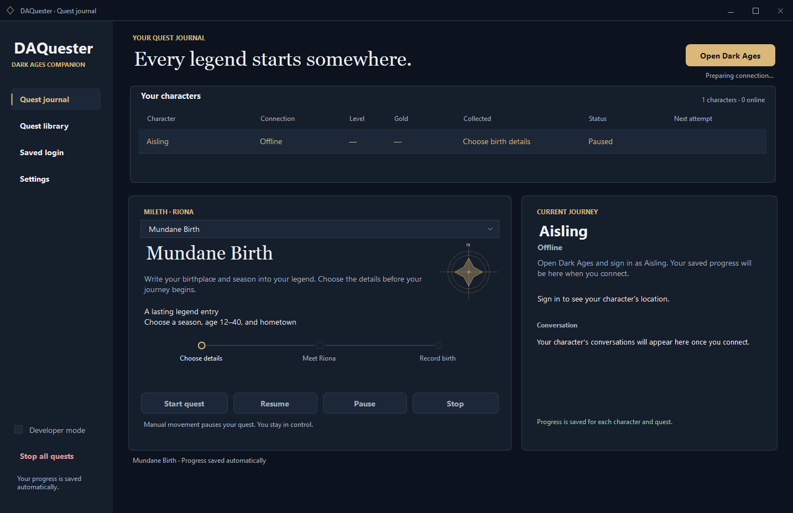
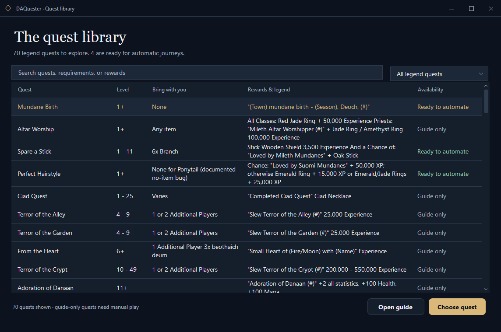
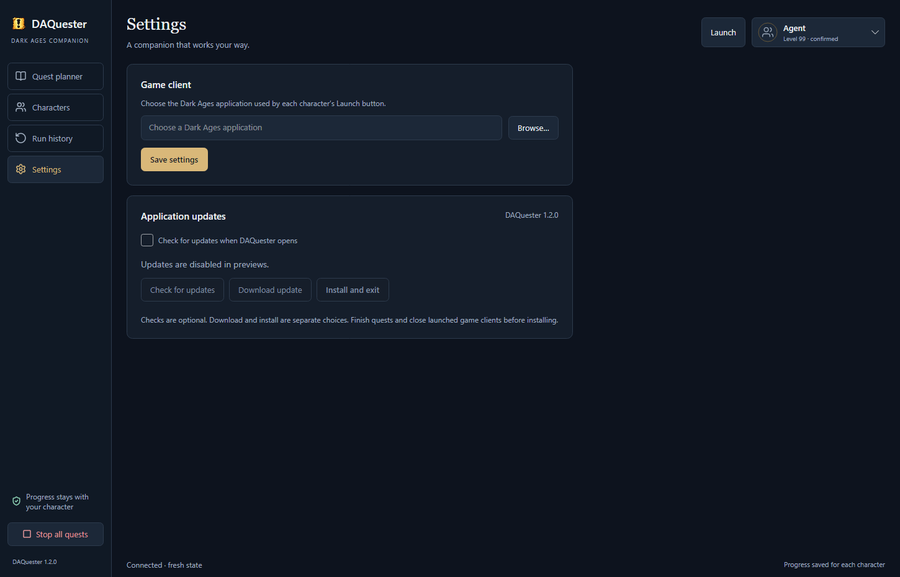

<div align="center">

# DAQuester

**Every legend starts somewhere.**

A midnight quest journal for Dark Ages.
Choose a character, follow the journey, and keep the rewards you earn.

[](https://github.com/BuildWithRaymond/DAQuester/actions/workflows/build.yml)
[](https://github.com/BuildWithRaymond/DAQuester/releases/latest)
[](LICENSE)
[](docs/GETTING_STARTED.md)
[](global.json)

[**Download for Windows**](https://github.com/BuildWithRaymond/DAQuester/releases/latest) · [Getting started](docs/GETTING_STARTED.md) · [Report a bug](https://github.com/BuildWithRaymond/DAQuester/issues/new/choose)

</div>



## Your next chapter

- **A focused quest journal.** Characters, requirements, conversations, stages and rewards in one fully dark workspace. Dark window frames, menus, dialogs and scrollbars included.
- **Four journeys ready to run.** Spare a Stick, Mundane Birth, Perfect Hairstyle and Entered Muisir Village use observed server replies and saved checkpoints.
- **Progress that stays with you.** Pause, stop, reconnect and resume from durable character journals. Ambiguous transactions pause for review.
- **A library worth exploring.** Search 70 legend quests. Available recipes are clearly distinguished from quests that still need manual play.
- **Updates on your terms.** Optional startup checks, off by default. Download only when you choose, then install after finishing your quests and closing game clients.
- **Tools when you need them.** Developer mode reveals calibration, evidence recording, connection profiles and diagnostics.
- **Local storage.** Settings and journals stay on your Windows account. Optional saved passwords use Windows encryption; sign-in remains manual.
- **One account manager.** Edit every character name and masked password in one table, add/remove rows, then save the batch. Names appear in the journal immediately.

<table>
<tr>
<td width="50%"><br/><strong>Find your next legend.</strong></td>
<td width="50%"><br/><strong>You choose when to update.</strong></td>
</tr>
</table>

*Actual isolated application renders with sample characters. No game artwork or credentials are bundled.*

## Start a journey

1. Download **DAQuester-win-Setup.exe** from [Releases](https://github.com/BuildWithRaymond/DAQuester/releases/latest), or extract **DAQuester-win-Portable.zip**. Both include .NET.
2. Open **Settings** and select your supported `Darkages.exe`. Add character names and optional passwords in **Account manager**, then **Save accounts**. Restart DAQuester after changing the game client.
3. Choose **Open Dark Ages** and sign in manually. Select the connected character and a quest, then **Start quest**.
4. Use **Pause**, **Resume** or **Stop** as needed. Progress is saved automatically.
5. If desired, enable **Check for updates when DAQuester opens** in Settings. Checks never download automatically; **Download update** and **Install and exit** are separate choices.

**Supported client:** Windows and the exact Dark Ages DATester 7.41 executable documented in [provenance](docs/provenance.md). Other binaries are rejected. Clients must be launched through DAQuester to use its proxy. It does not attach to existing clients.

Coming from an earlier folder build? Read [data migration](docs/GETTING_STARTED.md#existing-data) before first launch. Data now lives in `%LOCALAPPDATA%\DAQuester\Data`, outside the update package. Downloads are unsigned; see [release trust and recovery](docs/RELEASING.md).

## The available quests

| Quest | What the journal does |
| --- | --- |
| **Spare a Stick** | Gathers six branches, follows Callough's conversation and verifies rewards. A permanent outcome ends repeat attempts. |
| **Mundane Birth** | Asks for season, age 12–40 and town before walking to Riona. Saves the actual completion notice; never repeats an existing birth blindly. |
| **Perfect Hairstyle** | Visits Eeva for the observed Ponytail flow. Weekly attempts continue until the character's own Suomi legend is verified. Rings and XP alone are recorded as attempts. |
| **Entered Muisir Village** | Gathers five Undine Mushrooms, follows Kiril's Tiny Cave dialogue and verifies the legend and four Shrinking Potions. Leaves the potions carried. |

The other library entries are linked research metadata, with uncertain requirements marked for review. They do not have automatic recipes. See [quest details and live evidence](docs/QUESTS.md) and [validation status](docs/validation.md) for current limits.

## Build and contribute

Requires Windows and the [.NET 10 SDK](https://dotnet.microsoft.com/download/dotnet/10.0). No game installation is needed to build or run synthetic tests.

```powershell
git clone https://github.com/BuildWithRaymond/DAQuester.git
cd DAQuester
dotnet restore DAQuester.slnx -m:1
dotnet build DAQuester.slnx -c Release --no-restore -m:1
dotnet test tests/DAQuester.Tests -c Release --no-build -m:1
./tools/Test-UI.ps1
./tools/Build-Release.ps1
```

CI runs protocol, recovery, navigation and update tests, renders the native UI with isolated data, checks for light surfaces and clipped buttons, and verifies Windows packages. Release tags pass the same checks before publication. See [CI](docs/CI.md), [releasing](docs/RELEASING.md), and [contributing](CONTRIBUTING.md).

| Path | Responsibility |
| --- | --- |
| `src/DAQuester.App` | Native dark UI, settings, credentials, update integration and local control bridge |
| `src/DAQuester.Core` | Quest rules, runner, journals, scheduling, update consent and data migration |
| `src/DAQuester.DarkAges` | Protocol, proxy sessions, client launch, maps, routing and observed commands |
| `tests/DAQuester.Tests` | Synthetic packets, transaction recovery, transport and update policy |
| `content` | Quest recipes, catalog, normalized routes, calibration and sanitized evidence |
| `tools` | UI checks and reproducible Windows release packaging |

More: [Architecture](docs/architecture.md) · [Control and MCP](docs/control.md) · [Source provenance](docs/provenance.md) · [Changelog](CHANGELOG.md).

## Companion projects

[DAOrganizer](https://github.com/BuildWithRaymond/DAOrganizer) brings inventory and banks together.
[DAMerchant](https://github.com/BuildWithRaymond/DAMerchant) handles merchant trading and listings.
[DASpeaker](https://github.com/BuildWithRaymond/DASpeaker) prepares speeches and announcements.

## License and credits

Original code and vector artwork: [MIT](LICENSE). Vendored code retains its upstream license; see [third-party notices](THIRD_PARTY_NOTICES.md).

Built with .NET, Windows Forms, [Arbiter](https://github.com/ewrogers/Arbiter) and [Velopack](https://github.com/velopack/velopack). Quest references link to [Vorlof](https://vorlof.com/quests.html). Dark Ages belongs to its respective owners. DAQuester is an independent community project, unaffiliated with the game publisher.
