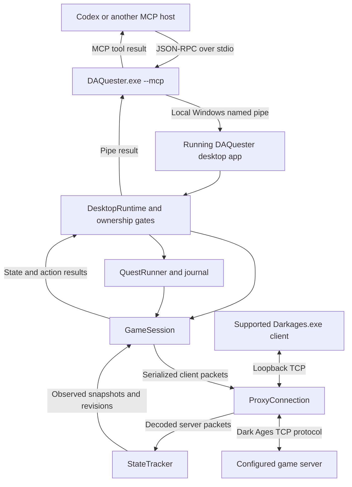

# How DAQuester's MCP interfaces with Dark Ages

Current implementation review: **October 13, 2026**.

DAQuester exposes game observations and controlled actions as MCP tools. An MCP
host, such as Codex, starts a small `DAQuester.exe --mcp` process. That process
forwards requests to the already-running desktop application through a local
Windows named pipe. The desktop application owns the game sessions, quest
runners, and TCP proxy connections. It turns approved commands into Dark Ages
client packets and uses actual server replies to establish what happened.

The game integration targets the hash-validated **DATester 7.41** client and the
`datester-7.41` profile. It is independent of a running Excalibur application.
Excalibur and DAOrganizer contributed protocol and behavior references; they are
not runtime control endpoints.

This document describes the current working-tree implementation, including
uncommitted changes. A read-only native `daquester_state` call during this review
confirmed that the running bridge was reachable and had the Fisk and Danaan
recipes loaded. It reported one connected character and one control action.
No character actions, launches, stops, exports, settings changes, or restarts
were issued for this review. That observation establishes bridge availability,
not that every source change or tool schema is loaded in the running executable.

## Contents

- [1. The complete connection path](#1-the-complete-connection-path)
- [2. Startup, client launch, and login](#2-startup-client-launch-and-login)
- [3. MCP and named-pipe contracts](#3-mcp-and-named-pipe-contracts)
- [4. How the proxy speaks the game protocol](#4-how-the-proxy-speaks-the-game-protocol)
- [5. What the agent can observe](#5-what-the-agent-can-observe)
- [6. The current MCP tool set](#6-the-current-mcp-tool-set)
- [7. Commands exposed through MCP](#7-commands-exposed-through-mcp)
- [8. Dialog identity and bounded reading](#8-dialog-identity-and-bounded-reading)
- [9. Purchases, equipment, and transaction receipts](#9-purchases-equipment-and-transaction-receipts)
- [10. Maps, travel, and movement](#10-maps-travel-and-movement)
- [11. Ownership, concurrency, and stopping](#11-ownership-concurrency-and-stopping)
- [12. Automatic quests and recovery](#12-automatic-quests-and-recovery)
- [13. Fighting and leveling](#13-fighting-and-leveling)
- [14. Persistence, diagnostics, and evidence](#14-persistence-diagnostics-and-evidence)
- [15. Privacy boundaries and current gaps](#15-privacy-boundaries-and-current-gaps)
- [16. Configuration and example requests](#16-configuration-and-example-requests)
- [17. Failure handling](#17-failure-handling)
- [18. Current limitations and validation](#18-current-limitations-and-validation)
- [19. Source-code map](#19-source-code-map)

## 1. The complete connection path



There are two distinct local transports:

| Transport | Purpose |
| --- | --- |
| Stdio between the MCP host and `--mcp` | Carries tool discovery, arguments, and results. |
| Windows pipe `DAQuester.Control.v1` | Connects the MCP adapter or `--control` caller to the desktop runtime. |
| Loopback TCP between the game client and proxy | Carries the actual game protocol. |
| TCP between the proxy and configured remote endpoint | Carries server traffic and player/automation packets. |

The MCP adapter does not construct a second quest engine or game connection.
The desktop window and MCP share the same runtime, sessions, journals, queues,
calibration, and ownership checks. `--control` is another entry point to that
same bridge.

Sources: [Program.cs](../src/DAQuester.App/Program.cs),
[ControlMain.cs](../src/DAQuester.App/ControlMain.cs),
[DesktopRuntime.Control.cs](../src/DAQuester.App/Services/DesktopRuntime.Control.cs).

## 2. Startup, client launch, and login

### Desktop startup

Normal startup loads settings, content recipes, saved journals, character memory,
queues, scheduler state, and the profile's calibration. `DesktopRuntime.StartAsync`
starts three configured loopback listeners, then the named-pipe control server.
The pipe is also started when proxy initialization fails, allowing diagnostics
to explain why game connectivity is unavailable.

The shipped connection defaults are local ports `2910`, `2911`, and `2912`,
paired with remote ports `2610`, `2611`, and `2612`. These are source defaults;
the user's saved profile determines the running configuration. Owned launches
and redirects also use dynamically allocated, one-shot loopback listeners.

Launching `--mcp` takes a separate startup branch before the normal desktop
window and instance mutex. It serves stdio and calls the pipe. It does not
automatically start the desktop application.

### Supported client launch

`daquester_launch` calls the existing owned-launch workflow. It focuses an
already-owned live client when possible, rejects a duplicate launch for an
already-connected character, and checks scheduler ownership.

For a new client, the launcher:

1. Verifies the executable against the two supported DATester 7.41 SHA-256 hashes.
2. Creates a fresh process suspended.
3. Patches that process's memory to use localhost and the owned proxy port,
   including the fallback address, multi-instance behavior, intro behavior,
   and supported agreement bypass.
4. Reads back patches to verify them, flushes the instruction cache, and resumes
   the new process.

The game executable on disk is unchanged. These operations apply to a newly
created supported `Darkages.exe`, not an existing Excalibur process. Launch
failure cleanup can terminate the new still-suspended process it just created.

### Saved credentials

Passwords are stored separately from `profiles.json`, in per-character files
under `Data/logins`, protected with Windows DPAPI for the current user.

Saved login uses an owned `SavedLoginTicket`:

- The native form receives a random numeric ticket in the password field.
- The form automation verifies focus, character, and field contents before
  submitting once. A shared login gate serializes form input across launches.
- Only the proxy associated with that launch can replace the exact matching
  character/ticket with its vault password in the outgoing login packet.
- The replacement retains the client's remaining login metadata. The ticket is
  single-use, expires after two minutes, and is revoked on cancellation.
- Authentication waits for server-observed character identity; a submitted form
  alone is insufficient.

Without a saved password, the workflow opens the owned client for manual sign-in.
It does not attach to an unrelated player-opened session.

Sources: [DesktopRuntime.Launch.cs](../src/DAQuester.App/Services/DesktopRuntime.Launch.cs),
[ClientLauncher.cs](../src/DAQuester.DarkAges/Launcher/ClientLauncher.cs),
[CredentialVault.cs](../src/DAQuester.App/CredentialVault.cs),
[SavedLoginTicket.cs](../src/DAQuester.Core/SavedLoginTicket.cs).

## 3. MCP and named-pipe contracts

### Stdio MCP

`ControlMain` reads one JSON-RPC message per line and writes one response per
line. Stdout contains protocol responses; diagnostics use stderr. Input lines
longer than 65,536 characters are rejected with a diagnostic. The code calls
this a 64 KiB limit, although the check is on string length.

`McpProtocol` implements:

| Method | Current behavior |
| --- | --- |
| `initialize` | Announces protocol version `2025-06-18`, tools capability, server name `DAQuester`, and adapter version `0.2.0`. |
| `ping` | Returns an empty result. |
| `tools/list` | Returns 14 `daquester_*` tools with descriptions and input schemas. |
| `tools/call` | Converts the tool name and arguments into a `ControlRequest`, then invokes the pipe. |
| Notifications without `id` | Produce no response and are ignored. |
| Other request methods | Return JSON-RPC error `-32601`. |

The adapter's hard-coded `0.2.0` is not the desktop release version. Tool results
contain a text content block whose text is serialized JSON. There is no separate
`structuredContent` result. Tool execution exceptions return `isError: true`;
other handling/parsing exceptions currently use `-32602`.

The schemas advertise types, enum values, and `additionalProperties: false`.
The adapter does not run a general JSON Schema validator itself. The desktop
and session code enforce their own requirements, allowed commands, ownership,
and state checks.

### Local control pipe

The pipe server uses `PipeOptions.CurrentUserOnly`. It accepts local clients
under the same Windows user, with up to 16 pipe instances. Each connection
carries one request and one result or error, encoded as newline-delimited UTF-8.

A request is shaped as:

```json
{
  "method": "command",
  "character": "YourCharacter",
  "arguments": {
    "kind": "inspect-self"
  }
}
```

The client waits up to five seconds to connect. The server allows ten seconds
to receive the request line and rejects lines longer than 65,536 characters.
Those limits do not bound the subsequent game action's duration. The handler is
dispatched into the desktop runtime's UI context and remains asynchronous while
waiting for server evidence.

**A stdio adapter processes calls sequentially.** It awaits the current tool
before reading another line. A `state` or `stop` request behind a long navigation
on the same adapter cannot overtake it. The desktop UI or an independent bridge
client can reach the app while that call is pending, subject to ownership rules.
MCP cancellation notifications are not implemented as game-action cancellation.

Sources: [ControlMain.cs](../src/DAQuester.App/ControlMain.cs),
[ControlProtocol.cs](../src/DAQuester.DarkAges/Control/ControlProtocol.cs),
[ControlPipe.cs](../src/DAQuester.DarkAges/Control/ControlPipe.cs).

## 4. How the proxy speaks the game protocol

`ProxyHost` accepts the client on loopback and opens a corresponding connection
to the configured game endpoint. Each `ProxyConnection` runs client-to-server
and server-to-client pumps concurrently.

### Frames and encryption

The frame reader handles fragmented and coalesced TCP data. A frame begins with
`0xAA`, followed by a two-byte length and an opcode. `PacketFrameBuffer` gathers
complete frames, performs bounded signature recovery, and detects repeated
framing corruption. Its wrapper prevents buffered data exceeding 262,144 bytes.

Vendored Arbiter types implement packet serialization, encryption parameters,
command-specific encryption, and sequence handling. The proxy learns seed/key
material from the server version response and the client's redirect handshake.
Those keys belong to the transport; they are not MCP command arguments.

Manual client packets and DAQuester-generated packets share a `toServer`
semaphore and the proxy's outgoing sequence. The proxy rewrites walk counters
through the same ordered path. A separate `toClient` semaphore orders forwarded
server packets and client-only presentation messages.

### Redirects and authentication

When the server sends a redirect, the proxy creates a unique one-shot loopback
listener for the destination and rewrites the client's redirect address/port.
The owned launch association follows that redirect, preventing another
character's connection from consuming its login ticket.

Every resulting proxy connection has a new generation. The old connection emits
an interruption; the runtime binds a new `GameSession` after observed identity.
The name comes from the client handshake, and the entity ID is established from
the server's identity packet. A redirect is not permission to continue commands
bound to the old generation.

### Server observation and presentation

Incoming server packets are decoded into `StateTracker` before the game client
receives them. Relevant packets update immutable character snapshots and raise
observation/change events. Unsupported state opcodes can still be forwarded and
recorded. A significant decode failure interrupts automation while the raw
server frame still passes to the client; selected combat-only decode exceptions
are tolerated without stopping quest execution.

Fast movement may send presentation packets to keep the visible game client in
sync. Merchant close also uses a client-only presentation packet. These do not
create server evidence or change the observed character snapshot.

### Main packets used by the interface

Opcodes are direction-specific: client `0x10` is a transfer handshake, while
server `0x10` removes an inventory slot. MCP callers supply semantic commands;
the implementation supplies these wire details.

| Client opcode | Role |
| --- | --- |
| `0x03` / `0x10` | Login / transfer handshake; owned login-ticket replacement and connection setup. |
| `0x06` / `0x11` | Walking / facing direction. |
| `0x07` / `0x08` | Item pickup / drop. |
| `0x0E` | NPC speech. |
| `0x13` / `0x3E` / `0x0F` | Attack / skill / spell, used by internal action handlers. |
| `0x1C` | Use an inventory item, including equipping through internal handlers. |
| `0x2D` | Own self-look request. |
| `0x38` | Refresh request used by movement recovery. |
| `0x39` / `0x3A` | Merchant / pursuit reply. |
| `0x43` | Object interaction/info request, including opening an NPC. |
| `0x44` | Equipment removal. |
| `0x47` / `0x4A` | Stat allocation / exchange, used internally. |

| Server opcode | Observed role |
| --- | --- |
| `0x00` / `0x03` | Version/encryption setup / redirect. |
| `0x05` / `0x52` | Character appearance/identity signals used by transport authentication. |
| `0x04` / `0x0B` | Authoritative position / own movement. |
| `0x07` / `0x0C` / `0x0E` / `0x33` | Draw/move/remove entities and human appearances. |
| `0x08` | Character status, including resource totals. |
| `0x0A` | System messages; type 3 is the recorded active outcome channel. |
| `0x0F` / `0x10` | Add/update or remove inventory slots. |
| `0x15` | Actual map ID/name/dimensions. |
| `0x17` / `0x18` / `0x2C` / `0x2D` | Add/remove spells and skills. |
| `0x2E` | World-map menu. |
| `0x2F` / `0x30` | Merchant screen menu / pursuit page or close. |
| `0x37` / `0x38` | Add/remove equipment. |
| `0x39` | Own self-look and complete own legend. |
| `0x42` | Exchange observations. |
| `0x58` | User-ready signal establishing inventory/spell-list readiness. |

These are the pinned implementation's definitions, not a claim that all packets
or variants are fully modeled. See [ClientCommand.cs](../src/DAQuester.DarkAges/Vendor/Arbiter.Net/Client/ClientCommand.cs)
and [ServerCommand.cs](../src/DAQuester.DarkAges/Vendor/Arbiter.Net/Server/ServerCommand.cs).

Sources: [ProxyHost.cs](../src/DAQuester.DarkAges/Transport/ProxyHost.cs),
[ProxyConnection.cs](../src/DAQuester.DarkAges/Transport/ProxyConnection.cs),
[PacketFrameBuffer.cs](../src/DAQuester.DarkAges/Protocol/PacketFrameBuffer.cs),
[StateTracker.cs](../src/DAQuester.DarkAges/Protocol/StateTracker.cs).

## 5. What the agent can observe

`daquester_state` returns connected/session entries, saved queues, recipes,
calibration, selected quest, recorded-event count, and active control owners.
Each character entry includes `snapshot`, `observedMap`, its last `discovery`
report, a quest `job`, and a visible movement counter.

The character snapshot includes:

| Area | Observed data |
| --- | --- |
| Identity and freshness | Character name/ID, connected flag, generation, revision. |
| Resources | Level, gold, XP, HP/max HP, mana, weight/capacity, stats and other status fields. |
| Location | Map ID/name, authoritative position, visible entities, visible ground items. |
| Possessions and abilities | Bag slots/items/quantities, equipment slots, skills, spells, cooldowns, status effects. |
| Own legend | Complete own marks when known, with a separate legend revision. |
| Dialog | Current server page, NPC/entity, pursuit, step, type, options, prompt, offered Next, stock prices, and dialog revision. |
| Relevant outcomes | Recognized quest notices, combat/entry refusal revisions, exchange state, durability and capacity signals. |
| Presentation | Appearance, motion, and short-lived feedback used by the desktop UI. |

`InventoryKnown`, `SpellsKnown`, and `LegendsKnown` distinguish an unknown list
from a known empty list. Disconnect clears readiness flags and transient state.
Some old numeric values can remain in a disconnected snapshot; they must not be
treated as current resources.

`StateTracker.Notice` retains recognized quest notices, not every active line.
Every active `0x0A` type-3 message is separately sent to diagnostics and retained
in replay recording. Other `0x0A` types are excluded from those replay records.
A page saying a reward will be granted is distinct from a numeric/item receipt
or an actual active outcome message.

### Generation and revision

- **Generation** identifies a proxy connection. It changes on replacement or
  reconnect. Generation allocation is epoch-based and shared across hosts so
  values do not simply restart at one after app startup.
- **Snapshot revision** advances as state is published within that generation.
- **Dialog revision** identifies the observed page. Unrelated state updates do
  not authorize a choice against a different page.
- **Legends revision** identifies the last complete own self-look response.

`GameSession.WaitAsync` looks for a matching observation after the supplied
revision in the same generation, using both current state and bounded evidence
history. This lets it retain a brief terminal page even when a following packet
closes it. It throws on disconnect/replacement or evidence timeout.

Sources: [Character.cs](../src/DAQuester.Core/Character.cs),
[GameSession.cs](../src/DAQuester.DarkAges/GameSession.cs),
[EvidenceHistory.cs](../src/DAQuester.Core/EvidenceHistory.cs).

## 6. The current MCP tool set

The current source advertises **14 tools**. `character` scopes applicable reads
or actions; it is required for `command`, `calibrate`, `start`, `fight`, and
`level`. Some methods accept that field but operate on app-wide data anyway.

| Tool | Purpose and scope |
| --- | --- |
| `daquester_state` | Read session snapshots, dialogs, jobs, queues, recipes, and owner state. Optional character filter. |
| `daquester_map` | Read a recorded map and collision rows (`#` blocked, `.` open). Defaults to map 500. Character permits that session's currently observed unrecorded map dimensions. |
| `daquester_command` | Perform one guarded command or bounded discovery operation for a connected character. |
| `daquester_start` | Prepare and start an automatic quest in the background. Returns saved choices, not a completion receipt. |
| `daquester_stop` | Cancel matching runtime owners and pending launches. Omitted character is global. Clients stay open. |
| `daquester_launch` | Launch/focus an owned supported client, using saved login where available. |
| `daquester_fight` | Start the background melee fighter for a connected character. |
| `daquester_level` | Start background Mileth crypt hunting, floor assessment, optional stat spending, and drop survey. |
| `daquester_calibrate` | Start a monitored live Spare a Stick calibration run; it operates the character. |
| `daquester_calibration` | Read calibration, or replace it using a JSON string when no active operations exist. |
| `daquester_settings` | Read settings, or replace only connection fields using a JSON string. Listener/session changes require a DAQuester restart. |
| `daquester_log` | Read retained in-memory diagnostic lines, optional tail `count`, file path, and write-failure status. |
| `daquester_export` | Write the app-wide in-memory replay to `Data/replays`; returns its path and event count. Character does not filter the export. |
| `daquester_analyze` | Analyze app-wide recorded quest evidence and candidate tree regions. Character does not filter this method. |

`state`, `map`, `analyze`, and read-only uses of `log`, `settings`, and
`calibration` do not submit game actions. `export` writes a local artifact.
`calibrate` is a game run; it must not be used as a synthetic test.

Source: [ControlProtocol.cs](../src/DAQuester.DarkAges/Control/ControlProtocol.cs).

## 7. Commands exposed through MCP

The public `command` schema and desktop allowlist currently expose **18 kinds**:

| Kind | What it does |
| --- | --- |
| `navigate` | Travel to `map` and `target` using known routes and collision. Can stop on an inventory goal. |
| `visit` | Approach a named NPC on a map. Its optional target participates in the NPC-anchor distance filter; it does not open the menu. |
| `interact` | Travel to a map/public-side approach, resolve the named visible NPC, and open its fresh menu. |
| `enter` | Probe one adjacent in-bounds doorway tile, await a real map transition/landing, and optionally take a bound inward step. |
| `step` | Move to one tile adjacent to the current observed position. |
| `open` | Resolve a named visible non-player NPC and wait for its fresh dialog. |
| `choose` | Select the matching text from the actual current dialog, using that dialog's identifiers. |
| `next` | Advance an actually offered pursuit Next and await the response. |
| `read-dialog` | Read the current page and bounded offered-Next continuation. It can submit Next actions. |
| `close` | Close the current pursuit and await server close, or dismiss a merchant menu in the client. |
| `input` | Answer the current observed text prompt. Merchant quantity prompts preserve their item argument. |
| `buy` | Select current merchant stock by item name; optional `quantity` performs the bound quantity flow and checks receipts. |
| `say` | Send speech; optional `replyFrom` waits for a fresh same-map dialog from that NPC. |
| `collect-ground` | Collect visible ground-item candidates along a route, using sprite `amount` and optional inventory `stopWhen`. |
| `pickup` | Send a pickup at `target` using known inventory and a free slot. The send itself is not an item receipt. |
| `inspect-self` | Request own self-look and wait for a newer complete own legend. |
| `repair` | Resolve a visible repair candidate and use the existing repair helper. See its special retry behavior below. |
| `unequip` | Remove an observed equipment slot once and require equipment/bag receipts. |

Shared arguments include `expectedGeneration`, `expectedDialogRevision`, and
`expectedPageText` for binding the action to the state just inspected. These
guards are checked before execution and again after movement is settled. They
are optional for ordinary commands; discovery `choose` with `readNext` requires
exact page text and dialog revision.

The public surface is narrower than internal `GameSession` capabilities. Quest
and combat handlers can use internal commands for bank deposits, equipping,
skills, spells, attacks, turns, item use, trades, drops, and stat changes. Those
are not general-purpose `daquester_command` kinds. MCP does not expose arbitrary
raw packet injection.

The bridge supplies its own observed dialog for `choose`, `next`, `close`,
`input`, and `buy`; caller-supplied dialog objects cannot replace server stock
prices or identifiers.

Sources: [DesktopRuntime.Control.cs](../src/DAQuester.App/Services/DesktopRuntime.Control.cs),
[Contracts.cs](../src/DAQuester.Core/Contracts.cs),
[GameSession.Discovery.cs](../src/DAQuester.DarkAges/GameSession.Discovery.cs).

## 8. Dialog identity and bounded reading

The server sends merchant menus and pursuit dialogs with different wire layouts.
`StateTracker` converts both into an observed `Dialog`. Replies are serialized
from its current entity/type, pursuit, step, option, and prompt fields.

`ResolveChoice` matches a unique current choice text case-insensitively, allowing
trailing periods. It does not infer an option from an old guide or a reused
number. Two pages can use the same pursuit/step and repeat a label such as `Yes`;
their full page text and revision still distinguish the actual terms.

### Bounded discovery

Set `readNext: true` on `interact`, `open`, `choose`, or `next`, or use
`read-dialog` to start from the current page. The reader:

1. Records each observed page.
2. Sends Next only when a pursuit actually offers Next without choices or input.
3. Stops at a choice, prompt, terminal page, closed dialog, changed NPC/map/session,
   page limit, interruption, or uncertain reply.
4. Returns `discovery.pages`, `stopReason`, any error, and own before/after
   resource snapshots. It omits the full entity list.

`maxPages` defaults to 12 and accepts 1 through 32. The source page counts toward
the limit. A discovery `choose` or `next` needs at least two pages. Stop reasons
include `choice`, `prompt`, `terminal`, `closed`, `state-changed`, `page-limit`,
`reconcile`, and `interrupted`.

This is bounded action batching, not a purely passive read: Next can release
items or rewards. The session marks a submitted discovery revision before
sending it, preventing that same revision from authorizing another submission
after an uncertain result. The last partial report is retained for `state`.

The reader leaves terminal popups open. In Danaan, Erin's final Next, reward
receipts, and terminal consecration-popup close are separate steps. Closing that
popup does not choose consecration or authorize another reward claim.

Sources: [GameSession.DialogueDiscovery.cs](../src/DAQuester.DarkAges/GameSession.DialogueDiscovery.cs),
[DialogPackets.cs](../src/DAQuester.DarkAges/Protocol/DialogPackets.cs).

## 9. Purchases, equipment, and transaction receipts

### Merchant purchases

`buy` requires a current observed merchant stock list (type 4), a matching item,
known inventory, and enough carried gold for its observed price. It selects the
item once. The reply may immediately deliver an item or provide a type-3
quantity prompt.

Without `quantity`, the command returns at the item increase or quantity prompt.
That does not establish a complete paid purchase. With `quantity`:

- The allowed control range is 1 through 65,535; it is not proof that every item
  supports that quantity.
- The helper checks total quoted cost before selecting.
- It answers only a newer prompt from the same NPC/generation with the matching
  item argument.
- It submits the quantity once and requires at least the requested item increase
  plus the exact quoted gold deduction.
- Partial direct delivery or missing receipts cannot trigger a second purchase.

`amount` is not a bulk-buy quantity. Manual `input` on a merchant type-3 prompt
also uses the observed item argument and may submit that revision only once.
The session stores this guard before sending, so a timeout does not free the
same prompt for another payment.

### Equipment removal

`unequip` accepts an observed equipment slot from 1 through 18 and optional exact
item name in `text`. Inventory must be known with a free bag slot. The helper
saves a session-local baseline before sending once, then requires both:

1. The equipped slot is absent.
2. The bag contains exactly one additional matching item.

Timeout/interruption leaves removal pending. Another removal is blocked until
both receipts reconcile. Carried and equipped weapons are separate facts:
Ceannlaidir's shrine requires an equipped weapon, while other destinations may
require its removal.

### Repair is a special case

The current repair helper uses the known repair-confirmation pursuit `92` on a
visible NPC candidate. It treats a gold decrease or the repair reply as success,
and has up to two attempts with 1.5-second response windows. It therefore does
not have the same single-submission semantics as the newer quantity purchase
and equipment-removal helpers. The native schema does not expose its internal
`entityId` parameter; ordinary MCP use selects a visible candidate.

### Action return versus receipt

Some commands wait for a precise receipt, some wait for a dialog, and some only
send. `say` without `replyFrom` and `pickup` are examples where a successful tool
return is not the intended NPC/item outcome. Resource packets and active replies
can arrive after a response. Use fresh observations to establish what actually
committed before further transactions.

Sources: [GameSession.Discovery.cs](../src/DAQuester.DarkAges/GameSession.Discovery.cs),
[GameSession.EquipmentRemoval.cs](../src/DAQuester.DarkAges/GameSession.EquipmentRemoval.cs),
[GameSession.cs](../src/DAQuester.DarkAges/GameSession.cs).

## 10. Maps, travel, and movement

### Where route knowledge comes from

`MapRepository` combines recorded map dimensions/portals/NPC transfers from
`content/routes.json` with collision grids. It reads installed client map assets
and `ia.dat` collision flags when available, including the Windows VirtualStore
location, and uses profile-specific packaged functional collision as fallback.

Routes are recorded knowledge. Live visible entities add temporary occupancy.
An NPC transfer's `PlanningArrival` estimates route cost; actual server position
proves arrival. Unknown connectivity is not filled in from a guessed map ID.

The server's map-size packet supplies actual map ID/name/dimensions.
`observedMap` exposes those dimensions. A newly visited map missing from the
repository can be added in session memory with empty portals/transfers. It does
not automatically become a persistent route record. Use `daquester_map` with
that character and map ID to inspect it; collision assets are still required.

### NPCs behind counters

`visit` uses an NPC-anchor distance filter. A safe public-side approach may be
farther from the drawn NPC than that filter permits. In that case, `navigate`
then `open`, or `interact` with a public-side `target`, keeps the approach bound
to reachable tiles. `interact` verifies the map before opening the named NPC.

### Discovering an unrecorded doorway

`enter` sends one ordinary move to an adjacent in-bounds tile on the currently
observed map, then waits for a different map and authoritative landing. Optional
`map` validates the destination after arrival; it is not a teleport request.

An optional `inwardTarget` requires an explicit destination map. After actual
landing, it must be adjacent, walkable, unoccupied, and outside recorded
triggers. Its move requires a separate server position receipt. Unexpected
landing, changed state, or timeout stops the helper without retrying entry.

Doorway departure is part of live entry procedure. Immediately move inward from
the actual landing and continue to a proven stable approach when needed before
reading menus or pausing. One acknowledged inward tile can still permit a later
pullback. Known research exceptions include Room 7's approach `(2,3)` and Monk
Hall's corridor departure north to `(2,6)`, then onward to `(6,8)`.

Read actual entry refusals. `Your must be armed to enter here.` requires
equipment reconciliation before another shrine approach. Town weapon-removal
behavior must not be applied to that armed shrine.

### Acknowledged movement and fast mode

Normal walking waits for server movement/position evidence. Fast mode uses a
bounded pending-step window: initially three, adapting to acknowledgment timing
and capped at four. A projected transport position is bookkeeping, never a
server position or quest receipt.

Fast cadence is 160 ms when conditions allow. It falls back to 430 ms near other
players within Manhattan distance 20 and in maps 10056/10180. Other own characters
connected through DAQuester are excluded from the nearby-player slowdown check.
With fast mode disabled, the configured cadence is used (default 400 ms).

The walker rechecks occupancy, generation, origin, and movement conditions before
sending, drains pending movement before triggers/transfers, and handles server
corrections through reanchoring or a refresh barrier. This movement recovery is
distinct from retrying an uncertain payment, handoff, or reward claim.

Sources: [MapRepository.cs](../src/DAQuester.DarkAges/Navigation/MapRepository.cs),
[TravelPlanner.cs](../src/DAQuester.DarkAges/Navigation/TravelPlanner.cs),
[GameSession.FastMovement.cs](../src/DAQuester.DarkAges/GameSession.FastMovement.cs),
[GameSession.MovementCadence.cs](../src/DAQuester.DarkAges/GameSession.MovementCadence.cs),
[ProxyConnection.Movement.cs](../src/DAQuester.DarkAges/Transport/ProxyConnection.Movement.cs).

## 11. Ownership, concurrency, and stopping

Ownership is enforced per character inside the desktop runtime. A preparing
quest, active control action, queue reservation, or scheduler reservation can
block another operation. A paused queue with an unresolved active checkpoint
continues to reserve its character until released through the existing workflow.

For an admitted individual command, the bridge pauses that character's existing
standalone runner, rechecks ownership and captured session identity, installs a
control cancellation owner, executes, and removes that owner in `finally`.
`GameSession.actions` serializes session commands; transport semaphores serialize
packet writes. Independent characters can still have independent work.

`stop` uses the runtime's shared cancellation/checkpoint workflow, including
matching pending launches, queues, runners, and control actions. It does not
close game clients. Omitted character applies globally and should not be used
to take over another agent's or player's work.

Current ordinary manual client movement, turns, and NPC/dialog interactions are
forwarded without canceling automation. A manual walk reanchors pending movement,
but is not a Stop receipt. Some older descriptions/comments say manual input
ends fighting; the current transport and its tests establish that ordinary
manual packets do not raise the interruption used by those owners. Use the
explicit Stop workflow when cancellation is intended.

Disconnects, redirects, significant protocol errors, and replacement sessions
interrupt unsafe work. A tool timeout at the MCP host is different: it does not
prove cancellation or non-commitment. The adapter has no request-cancellation
mapping that automatically revokes the runtime action.

The pipe authenticates a Windows user, not an individual agent. The runtime
does not issue MCP-client ownership tokens. Agents must respect existing
reservations and must not release someone else's owner merely to make a new
command pass.

Sources: [DesktopRuntime.Control.cs](../src/DAQuester.App/Services/DesktopRuntime.Control.cs),
[DesktopRuntime.Queue.cs](../src/DAQuester.App/Services/DesktopRuntime.Queue.cs),
[DesktopRuntime.Scheduler.cs](../src/DAQuester.App/Services/DesktopRuntime.Scheduler.cs),
[TransportTests.cs](../tests/DAQuester.Tests/TransportTests.cs).

## 12. Automatic quests and recovery

`daquester_start` prepares the same `QuestRunner` used by the application. It
returns after starting background execution. Poll `state` for job status,
pending transactions, continuation waits, cleanup, and verified completion.

The native schema currently advertises eight quest IDs:

| Quest ID | Current choice/repeat contract |
| --- | --- |
| `spare-a-stick` | Default quest; calibration-gated. Optional repeat honors the eight-hour cooldown. Permanent Callough completion disables further attempts. |
| `mundane-birth` | Explicit season, whole-number age 12–40, and town on first start. Choices lock around submitted progress. No repeat or automatic birth rewrite. |
| `perfect-hairstyle` | Documented no-item path; automatically waits seven days between eligible attempts until the own Suomi legend goal is proved. |
| `entered-muisir-village` | No permanent choice; verifies own legend, consumed mushrooms, and newly received potions. No repeats. |
| `emerald-dawn` | Explicit recipient outcome. Registration/level/own-legend gates apply. Recipient can change only before the insignia handoff. No repeat. |
| `shinewood-faerie` | Pet and eligible missing spells; dangerous walking requires explicit acceptance when no prepared return exists. A later explicit start may check newly unlocked spells; no general repeat schedule. |
| `fisk-secret` | Secrecy path only. Paid bouquet wait is a saved continuation; elapsed time permits a check, never proves collection. No repeat. |
| `cap-band-of-danaan` | Shared Cap/Band family. Explicit `avatar: "cail"` and player acceptance of the supplied-Mold rite risk. Unknown variants stop; consecration/reversion remain separate unselected choices. No repeat. |

The four original quest policies remain distinct: Stick cooldown/permanent stop,
immutable Birth choices, Hairstyle's weekly legend goal, and Muisir's one-time
verified outcome. A single generic retry or repeat rule cannot replace them.

The runtime loads more recipes than this enum lists. The read-only check found
14 loaded IDs, also including `aided-pact-of-anaman`, `altar-worship`, `awakening`,
`crypt-climb`, `cured-sick-child`, and `peasants-first-steps`. The pipe's start
handler looks up loaded recipes rather than enforcing the advertised enum.
Loaded recipes and public native-MCP start support are therefore different
surfaces; additional UI consent/choice requirements may apply. A cached chat
tool schema can also lag behind an executable update.

### Durable transactions

Automatic quest handlers save a pending transaction baseline before potentially
committing actions. Journals include stage, immutable choices where applicable,
generation/revision, resource baselines, submitted pages, waits, and cleanup.
Atomic writes preserve the previous checkpoint if replacement fails.

Resume inspects fresh server state. It cannot assume an old payment committed
from a new-session gold balance or resend a handoff because its reply timed out.
Recognized permanent own marks can establish a finished goal. Saved planning
facts never masquerade as fresh runtime reward receipts.

Direct manual `command` calls do not automatically create a durable quest journal
entry. The duplicate guards for merchant input, discovery pages, and equipment
removal are session-local. Their safety does not amount to universal persistent
idempotency across app restart/reconnect.

### Fisk and Danaan specifics

Fisk saves Viveka's paid acceptance and due time separately from the actual new
Special Bouquet. When queued work is ready it can yield that continuation;
otherwise the existing waiting allocator uses free Tavern tiles `(10–14,1)` and
verifies facing down. It never repays automatically or preempts another active
unresolved checkpoint.

Danaan saves Cail/rite choices and keeps Erin's item receipt, numeric XP, active
reward message, fresh own legend, and terminal-popup closure separate. Saved
cleanup resumes the close without another claim. Live discovery of Fisk secrecy
and one Cail/Cap outcome does not certify the new complete automatic runners.
Band delivery and unknown variations remain subject to the limitations in the
[automation handoff](research/fisk-danaan-automation.md).

Sources: [QuestRunner.cs](../src/DAQuester.Core/QuestRunner.cs),
[QuestRunPolicy.cs](../src/DAQuester.Core/QuestRunPolicy.cs),
[Journal.cs](../src/DAQuester.Core/Journal.cs),
[ObservedQuestState.cs](../src/DAQuester.Core/ObservedQuestState.cs).

## 13. Fighting and leveling

These are separate background control owners, not raw packet APIs. They require
a connected character and reject conflicts with quests, queues, or control work.

`daquester_fight` uses the melee helpers to select nearby monsters, approach,
face, equip a usable weapon where necessary, and attack with suitable skills.
Own connected characters are excluded as targets. Public options include:

- `sprites`: preferred monster sprite IDs; `priorityOnly` restricts to them.
- `roam`: defaults true; searches waypoints when no target is in reach.
- `idleSeconds`: default 120 with roaming, 30 without roaming when omitted;
  advertised range 5–3600.
- `retreatMap`, `retreatX`, `retreatY`, and optional `retreatPlace`: low-health
  retreat destination. Below 30% HP it breaks off and uses retreat when supplied.

`daquester_level` uses the Mileth crypt hunting engine. It samples one-on-one
kills and classifies floors by damage/time, retreats from hard or surrounded
conditions, considers deeper stairs after easy progression, and returns to
safety to recover below its low-health threshold. Its public options include:

| Option | Current default/meaning |
| --- | --- |
| `targetLevel` | Optional stop goal, advertised range 1–99. |
| `samples` | 3 samples for floor assessment. |
| `tooHardPercent` / `tooSlowSeconds` | 25 / 20. |
| `easyPercent` / `fastSeconds` | 10 / 10. |
| `keep` | Item names to retain; the survey collects drops for identification and drops other items again, retaining gold. |
| `untilSafe` | Optional maps which must all be judged safe before stopping. |
| `spendStats` | Explicit or remembered per-character setting; current runtime uses `StatPaths.Strict` and persists the preference. |

Hunting progress and per-floor reports are saved under
`Data/hunting/mileth-crypt`. These tools operate real gameplay when called.
Their presence or synthetic coverage is not proof that every combat encounter
or floor is safe.

The current strict stat path raises CON to 8, WIS to 8, CON to 13, then WIS to
13, saving later points. The tool description still refers to the longer
`Best` path (CON 22/WIS 40); the actual runtime construction uses `Strict`.

Sources: [DesktopRuntime.Control.cs](../src/DAQuester.App/Services/DesktopRuntime.Control.cs),
[MeleeFight.cs](../src/DAQuester.Core/MeleeFight.cs),
[HuntingEngine.cs](../src/DAQuester.Core/HuntingEngine.cs),
[FloorJudge.cs](../src/DAQuester.Core/FloorJudge.cs).

## 14. Persistence, diagnostics, and evidence

Normal user data is under `%LOCALAPPDATA%/DAQuester/Data`. The player window has
no Developer mode. Protocol diagnostics, calibration, connection profile, and
replay exports live in that folder and the control/MCP surface.

| Location | Role |
| --- | --- |
| `profiles.json` | Connection/client settings and character preferences; saved passwords live separately. |
| `logins/` | Current-user DPAPI-protected login files. |
| `journal/` | Per-character/per-quest hashed journal files, written atomically. |
| `queues/` | Saved queue order, active checkpoint, waits, and verified history. |
| `characters/` | Memory keyed by server profile and normalized character: observed level, base class, own legend, and appearance. |
| `scheduler.json` | Saved scheduling state and choices. |
| `calibration/<profile>.json` | Spare a Stick calibration and evidence references. |
| `diagnostics.log` | Appended diagnostic lines and active server messages. |
| `replays/` | On-demand and automatic replay exports. |
| `hunting/mileth-crypt/` | Hunting progress JSON and floor report Markdown. |

Character planning memory does not persist live inventory, dialogs, or runtime
identity/revisions. Queue history advances only after a settled verified outcome;
a paid wait is not a completed quest entry.

### Current retention

The file log appends each diagnostic line when writing succeeds. The in-memory
log currently trims to **2,000 lines**; `daquester_log` reads that memory, not the
entire file. This differs from existing wording promising every line in memory.
`logFileFailed` reports write failure, and the runtime retains a failure notice.

`ReplayRecorder` defaults enabled. It retains up to **30,000 events** and
**10,000 recorded actions**, dropping oldest entries at those bounds. Current
exports use **schema version 3**, with event time, character, generation,
revision, opcode, payload, snapshot, direction, and source (`client` or `bot`).
Export writes the current retained buffers, not an unlimited history.

On-demand `export` and automatic exports use the same recorder. Automatic
exports occur on a bound character's disconnect and application shutdown when
events exist. They are app-wide, so one disconnect can export observations
from multiple characters. Export is a file snapshot; it does not clear recording.

`analyze` correlates recorded server state/actions to derive quest evidence and
tree collection regions. An analyzer label, candidate region, or guide hypothesis
is not a substitute for the actual transaction receipt.

Sources: [DesktopRuntime.cs](../src/DAQuester.App/Services/DesktopRuntime.cs),
[ReplayRecorder.cs](../src/DAQuester.DarkAges/Diagnostics/ReplayRecorder.cs),
[QuestEvidenceAnalyzer.cs](../src/DAQuester.DarkAges/Diagnostics/QuestEvidenceAnalyzer.cs),
[CharacterMemory.cs](../src/DAQuester.Core/CharacterMemory.cs).

## 15. Privacy boundaries and current gaps

The current code explicitly suppresses client credential-bearing opcodes
`0x02`, `0x03`, and `0x26` before client-observation recording. It blanks outgoing
speech/whisper payloads (`0x0E`/`0x19`), drops server public chat (`0x0D`), and
records only active type-3 `0x0A` payloads. Login diagnostics report response
shape rather than raw login packets or vault passwords.

However, the replay's `Sanitized: true` field is an intent label, not a complete
redaction guarantee. Two implementation gaps are visible in the current source:

- Client handshake `0x10` and server version/redirect `0x00`/`0x03` are not
  explicitly excluded by those recorder filters. Their transport layouts can
  carry encryption parameters or handoff metadata. The observation path can
  pass them to the recorder.
- Replay snapshots retain the full `Entities` collection, and `state` also
  exposes visible entities. Export does not globally anonymize character names
  or scrub other-player entity data.

These are static code findings, not a claim that such payloads were present in
the running capture inspected during this review; no replay was exported or read.
The project requirement to omit credentials, handshake secrets, and other-player
private information remains stronger than the current generic export filters.
Research fixtures need deliberate allowlisting/normalization before being saved
or committed. The bounded discovery response reduces entity exposure, but does
not make a generic replay safe to publish automatically.

Sources: [ProxyConnection.cs](../src/DAQuester.DarkAges/Transport/ProxyConnection.cs),
[ReplayRecorder.cs](../src/DAQuester.DarkAges/Diagnostics/ReplayRecorder.cs),
[research evidence rules](../AGENTS.md), [provenance](provenance.md).

## 16. Configuration and example requests

The following examples explain request shapes. They were not executed as game
actions. Replace all example names, coordinates, revisions, and choices with
fresh observed values and the player's authorized preferences.

### Registering the adapter

The repository's [mcp-config.toml](../mcp-config.toml) currently specifies a
10-second startup timeout and 180-second tool timeout. The existing
[control guide](control.md) shows a longer 1,800-second tool timeout for extended
navigation. Configure an appropriate long timeout in the MCP host; increasing
it does not change individual server-receipt waits or authorize retries.

```toml
[mcp_servers.daquester]
command = 'C:\Tools\DAQuester\DAQuester.exe'
args = ["--mcp"]
startup_timeout_sec = 20
tool_timeout_sec = 1800
```

The executable path above is a deployment example, not a private workspace path.
The desktop app must already be running under the same Windows account, with
the intended characters connected through its launcher. Prefer the native
`daquester_*` tools exposed by the host once registered.

### Read current state

Native tool: `daquester_state`.

```json
{"character":"YourCharacter"}
```

Equivalent pipe request:

```json
{"method":"state","character":"YourCharacter"}
```

### Open a public-side NPC approach and read offered Next pages

Native tool: `daquester_command`.

```json
{
  "character": "YourCharacter",
  "kind": "interact",
  "map": 413,
  "target": {"x": 10, "y": 8},
  "text": "Viveka",
  "readNext": true,
  "maxPages": 12,
  "expectedGeneration": 123
}
```

The helper opens and reads; it stops before selecting offered choices. For a
choice whose informational meaning has been verified, bind the exact page:

```json
{
  "character": "YourCharacter",
  "kind": "choose",
  "text": "What did you find?",
  "readNext": true,
  "maxPages": 12,
  "expectedGeneration": 123,
  "expectedDialogRevision": 456,
  "expectedPageText": "Replace with the exact full current server page text."
}
```

These numeric values are placeholders, not captured identifiers. Exact binding
prevents stale state; it does not provide consent for a permanent quest choice.

### Buy a known quantity from the currently observed stock page

```json
{
  "character": "YourCharacter",
  "kind": "buy",
  "text": "Wine",
  "quantity": 5,
  "expectedGeneration": 123,
  "expectedDialogRevision": 456
}
```

Inspect the actual item and quoted gold receipts. Do not repeat the request
after a timeout without reconciliation.

### Probe an entry with a previously established inward tile

```json
{
  "character": "YourCharacter",
  "kind": "enter",
  "map": 169,
  "target": {"x": 58, "y": 38},
  "inwardTarget": {"x": 5, "y": 9},
  "expectedGeneration": 123
}
```

The outside target must be adjacent to the actual current position. The inward
tile is validated against actual arrival on the destination, not guessed from
the exterior approach.

### Starting the observed Danaan route

Native tool: `daquester_start`.

```json
{
  "character": "YourCharacter",
  "quest": "cap-band-of-danaan",
  "avatar": "cail",
  "acceptSuppliedMoldRite": true
}
```

The acceptance must come from the player for that character. It cannot be
inferred from this example. The response confirms a start, not a reward.

### Pipe access without MCP registration

Write an authorized `ControlRequest` into a JSON file, then invoke:

```powershell
& 'C:\Tools\DAQuester\DAQuester.exe' --control '.\request.json'
```

`--control` also accepts inline JSON, but a request file avoids shell quoting
issues. It returns the same runtime result/error as MCP.

## 17. Failure handling

| Situation | What it means and how to continue |
| --- | --- |
| Pipe connection timeout | The adapter could not reach the current user's desktop bridge. Inspect app/bridge availability. No game action receipt exists. |
| Connected-character requirement fails | The named session is absent or disconnected. Establish the intended owned connection before actions. |
| Queue/scheduler/control owner rejection | Another workflow reserves that character. Respect its owner and existing release procedure. |
| Expected generation mismatch | The inspected connection was replaced. Read fresh state and reconcile pending work. |
| Expected dialog/page mismatch | The page changed or closed. Inspect its actual terms before selection. |
| Missing route/collision | Navigation lacks supported data. Obtain observed route/asset evidence rather than inventing connectivity. |
| Unexpected doorway landing | The move reached a different destination/position than expected. Inspect arrival and stabilize the actual interior without repeating entry. |
| Server evidence timeout | A send may already have committed. Inspect current resources/dialog/active replies and saved pending state. |
| MCP host tool timeout | Transport waiting expired. The runtime action may still be active or committed. Do not automatically resubmit. |
| Discovery `reconcile` or `interrupted` | Inspect the retained partial report and fresh state. Do not resend its submitted page. |
| Background start succeeds but job pauses | Preparation/start was accepted; the runner later encountered a blocker. Read job reason and pending receipt. |
| Reward proved, final popup close uncertain | Resume presentation cleanup separately. Do not repeat the claim. |
| Log write failure | `daquester_log.logFileFailed` exposes it; in-memory diagnostic retention remains bounded. |

The implementation has several action-specific waits, commonly five seconds
for NPC/dialog/purchase/equipment receipts and two seconds for walking. A longer
MCP timeout cannot guarantee those server replies arrive. Successful automation
requires the action's actual expected receipt, not just a transport response.

## 18. Current limitations and validation

### What is implemented

- A local stdio MCP adapter and current-user named-pipe bridge.
- Shared runtime ownership, quest execution, and saved-login gates.
- Game packet forwarding, encryption/sequence handling, and observed state.
- Guarded commands, bounded dialog transcripts, quantity purchases, equipment
  removal, doorway discovery, route-aware movement, combat, and hunting helpers.
- Durable quest/queue checkpoints and action-specific reconciliation.
- Active-message recording, file diagnostics, bounded replays, and evidence analysis.

### What should not be inferred

- The adapter is not a generic Dark Ages client or a promise of support for other
  client binaries/server profiles.
- There is no MCP resources/prompts service, progress subscription, push state
  stream, or implemented cancellation-notification handler. State is polled.
- An accepted command is not universally an atomic transaction with a durable
  idempotency key. Several direct-command guards live only in the current session.
- A known map's dimensions/collision do not establish an unknown door or NPC
  transport. A movement acknowledgment does not establish permanent doorway stability.
- A recipe listed by state is not automatically a choice-complete native start API.
- Replay `Sanitized: true` does not prove complete handshake/other-player redaction.
- The MCP adapter's version string and cached tool schema do not establish the
  current desktop binary's source revision.
- Synthetic test success does not certify a live full quest route or every NPC variant.

### Relevant existing tests

| Coverage | Source |
| --- | --- |
| MCP handshake, schema, forwarding, notification behavior | [McpTests.cs](../tests/DAQuester.Tests/McpTests.cs) |
| Pipe request/result/error transport | [ControlPipeTests.cs](../tests/DAQuester.Tests/ControlPipeTests.cs) |
| Fragmented traffic, manual input, presentation/evidence separation | [TransportTests.cs](../tests/DAQuester.Tests/TransportTests.cs) |
| Owned tickets, redirects, login isolation | [OwnedLoginTransportTests.cs](../tests/DAQuester.Tests/OwnedLoginTransportTests.cs) |
| Fresh bindings, purchases, doorway landing/inward receipts | [DiscoveryCommandTests.cs](../tests/DAQuester.Tests/DiscoveryCommandTests.cs) |
| Bounded Next, stop reasons, uncertain submitted pages | [DialogueDiscoveryTests.cs](../tests/DAQuester.Tests/DialogueDiscoveryTests.cs) |
| Equipment plus bag receipts | [EquipmentRemovalTests.cs](../tests/DAQuester.Tests/EquipmentRemovalTests.cs) |
| Visited dimensions without invented routes | [VisitedMapTests.cs](../tests/DAQuester.Tests/VisitedMapTests.cs) |
| Desktop admission and observed shop/dialog binding | [ControlPurchaseTests.cs](../tests/DAQuester.AppTests/ControlPurchaseTests.cs) |
| Queue reservation and recovery | [QueueOwnershipTests.cs](../tests/DAQuester.AppTests/QueueOwnershipTests.cs), [QuestQueueTests.cs](../tests/DAQuester.Tests/QuestQueueTests.cs) |
| Fisk/Danaan automation, waits, rewards, and cleanup | [FiskDanaanAutomationTests.cs](../tests/DAQuester.Tests/FiskDanaanAutomationTests.cs), [DanaanRewardTests.cs](../tests/DAQuester.Tests/DanaanRewardTests.cs), [FiskCollectionWaitTests.cs](../tests/DAQuester.Tests/FiskCollectionWaitTests.cs) |

The existing [validation record](validation.md) reports 1,079 Core/protocol and
190 app tests passing for the October 13 Fisk/Danaan implementation. Those are
recorded prior results, not tests rerun for this documentation task. Its live
research milestone remains distinct from full automatic-run certification.
No build, real-character test, or packaging change was needed for this document.

## 19. Source-code map

| Responsibility | Main files |
| --- | --- |
| CLI mode selection | [Program.cs](../src/DAQuester.App/Program.cs) |
| Stdio and `--control` entry point | [ControlMain.cs](../src/DAQuester.App/ControlMain.cs) |
| Tool schemas/JSON-RPC | [ControlProtocol.cs](../src/DAQuester.DarkAges/Control/ControlProtocol.cs) |
| Pipe client/server | [ControlPipe.cs](../src/DAQuester.DarkAges/Control/ControlPipe.cs) |
| Runtime dispatch, admission, results | [DesktopRuntime.Control.cs](../src/DAQuester.App/Services/DesktopRuntime.Control.cs) |
| Startup, binding, recording, shutdown | [DesktopRuntime.cs](../src/DAQuester.App/Services/DesktopRuntime.cs) |
| Owned launch/login | [DesktopRuntime.Launch.cs](../src/DAQuester.App/Services/DesktopRuntime.Launch.cs), [Launcher](../src/DAQuester.DarkAges/Launcher/) |
| Game transport | [ProxyHost.cs](../src/DAQuester.DarkAges/Transport/ProxyHost.cs), [ProxyConnection.cs](../src/DAQuester.DarkAges/Transport/ProxyConnection.cs) |
| State/message parsing | [StateTracker.cs](../src/DAQuester.DarkAges/Protocol/StateTracker.cs), [Protocol](../src/DAQuester.DarkAges/Protocol/) |
| Commands/waits | [GameSession.cs](../src/DAQuester.DarkAges/GameSession.cs), [GameSession.Discovery.cs](../src/DAQuester.DarkAges/GameSession.Discovery.cs) |
| Dialog batch reader | [GameSession.DialogueDiscovery.cs](../src/DAQuester.DarkAges/GameSession.DialogueDiscovery.cs) |
| Guarded removal | [GameSession.EquipmentRemoval.cs](../src/DAQuester.DarkAges/GameSession.EquipmentRemoval.cs) |
| Maps and route planning | [Navigation](../src/DAQuester.DarkAges/Navigation/), [routes.json](../content/routes.json) |
| Recipes and quest engine | [recipes](../content/recipes/), [QuestRunner.cs](../src/DAQuester.Core/QuestRunner.cs), [ObservedJourney.Dialogue.cs](../src/DAQuester.Core/ObservedJourney.Dialogue.cs) |
| Durable journal writes | [Journal.cs](../src/DAQuester.Core/Journal.cs), [AtomicJsonFile.cs](../src/DAQuester.Core/AtomicJsonFile.cs) |
| Queue/checkpoint coordination | [QuestQueueCoordinator.cs](../src/DAQuester.Core/QuestQueueCoordinator.cs), [FileQuestQueueStore.cs](../src/DAQuester.Core/FileQuestQueueStore.cs) |
| Recording and analysis | [ReplayRecorder.cs](../src/DAQuester.DarkAges/Diagnostics/ReplayRecorder.cs), [QuestEvidenceAnalyzer.cs](../src/DAQuester.DarkAges/Diagnostics/QuestEvidenceAnalyzer.cs) |
| Vendor protocol implementation | [Arbiter.Net](../src/DAQuester.DarkAges/Vendor/Arbiter.Net/) |

Related references: [control usage](control.md), [architecture](architecture.md),
[quest policies](QUESTS.md), [provenance](provenance.md),
[MCP discovery improvements](research/mcp-discovery-improvements.md), and
[Fisk/Danaan automation handoff](research/fisk-danaan-automation.md).
